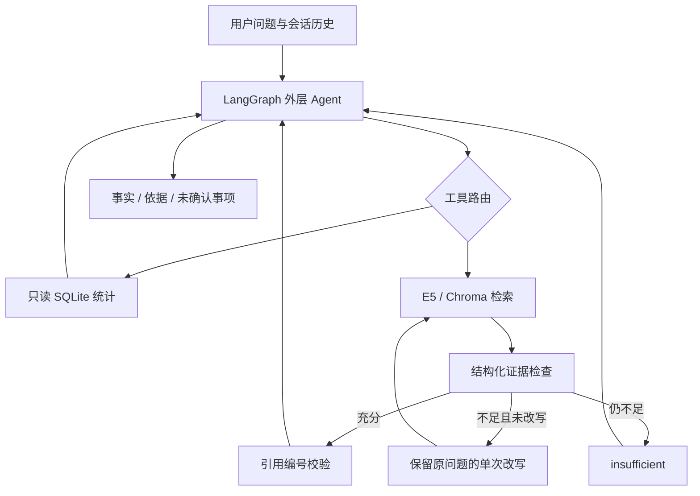

# Evidence First Agent · 有据可查的数据与资料问答助手

一个基于 **LangGraph + SQLite + E5 / Chroma + DeepSeek** 的个人 Agent 工程作品。以虚构船舶数据为场景，研究一个具体问题：**当用户同时问“数字是多少”和“为什么这样计算”时，怎样让 Agent 分开获取事实与依据，并在缺失、错误或预算耗尽时诚实停止？**

本项目处于本地原型阶段。数据均为 DEMO 示例，不提供实时航行建议。

## 先看一个例子

> 查询 DEMO-001 的平均航速，并说明缺失航速是否参与计算。

1. `get_ship_speed` 通过只读、参数化 SQL 查询，返回平均 **10.5 节**、有效 **3 条 / 总计 4 条**。
2. `search_documents` 检索规则原文，经过结构化证据充分性检查，返回片段编号。
3. Agent 分别组织“数值事实”和“资料依据”；不足时说明缺什么，不把缺失当作 0。

以上是期望的工作流程；真实模型的措辞与工具路由存在不确定性。无需模型即可执行的数据库演示见下方快速启动。

## 工程重点

| 问题 | 设计 | 代码入口 |
|---|---|---|
| 模型可能编造统计数值 | 数据由 SQLite 计算，模型仅传船号；只读连接与参数化查询 | `sqlite_repository.py` |
| 检索相关不等于证据充分 | Pydantic 结构化检查；拒绝本次检索之外的引用编号 | `evidence_graph.py` |
| 无止境工具调用造成成本失控 | 外层每轮输入最多 6 次模型请求；资料工具单次最多 3 次内部调用、一次改写 | `agent_graph.py` / `evidence_graph.py` |
| 执行失败被误解为“没有资料” | 区分 `ok`、`insufficient`、`tool_error`；保留执行日志 | `evidence_tool.py` / `tool_runtime.py` |
| 多轮指代混淆查询对象 | 保留进程内消息，歧义时追问；“清空”由程序处理 | `chat.py` |
| 更复杂的检索未必更好 | 比较向量、BM25、RRF；保留没有收益的实验结论 | `hybrid_search.py` / `eval/` |

**预算口径：外层 6 次不包含工具内部调用，不是整轮全局 6 次上限。** 当前没有全局 token 预算、工具调用总量限制或持久化会话恢复。

## 架构



详细取舍见 [工程设计与限制](docs/engineering.md)，试用流程见 [演示指南](docs/demo.md)。

## 快速启动

建议 Python 3.12，在仓库根目录运行。

### 1. 无需依赖和密钥：核验数据工具

```bash
python build_database.py
python demo.py
```

输出包含 DEMO-001（10.5 节）、DEMO-002（22 节）、DEMO-003（全部缺失）、DEMO-999（本地无记录）。此入口运行真实 SQLite 查询，不是模型问答演示。

### 2. 回归测试：不调用外部模型

```bash
python -m venv .venv
# Windows: .venv\Scripts\activate
# macOS/Linux: source .venv/bin/activate
python -m pip install -r requirements.txt pytest
python -m pytest
```

测试覆盖零值 / 缺失 / 无记录、SQL 参数化与只读、未知工具、执行异常、非法引用、预算停止、单次重检索和工具消息对应。CI 执行同样的测试与数据库演示，不使用真实 API Key。

### 3. 完整 Agent：需要 E5 模型和自己的 API Key

```bash
python -m pip install -r requirements-rag.txt
# 复制 .env.example 为 .env，填写自己的 API Key
# PowerShell: Copy-Item .env.example .env
# macOS/Linux: cp .env.example .env
python build_database.py
python build_index.py
python chat.py
```

首次建库需要联网下载 `intfloat/multilingual-e5-small`，之后检索器只从本地缓存加载。DeepSeek 回答仍需联网且可能产生费用。模型与接口通过 `.env` 配置；未配置密钥时启动会报明确错误。`build_index.py` 对相同 ID 执行 upsert；更换语料请使用新的 `CHROMA_COLLECTION_NAME`，避免遗留旧片段。

公开版只附带 **3 个自写项目规则片段**；第三方 PDF、模型权重、向量数据库和历史运行日志均不打包。完整 AIS 领域问答需要自行补充有权使用的资料。本仓库无旧项目的仓库链接、代码、生产配置或 Git 历史。

## 评测如何解读

- 历史检索开发实验：64 片段 / 20 题，向量、BM25、RRF 的 Hit@5 分别为 **17/20、12/20、17/20**。RRF 有 2 题改善、2 题退步，因此未作为主工具默认策略。见 [结果摘要](eval/retrieval_summary.json)。
- 历史整合开发案例：16 案例、19 个用户问题轮次，按预定条件审阅 **15 通过、1 未通过**。失败案例 DEV32 未执行资料检索，缺少要求的引用；保留失败，不改标准。见 [案例定义](eval/development_cases.json) 和 [逐条审阅](eval/development_review.json)。
- 上述为学习阶段的开发记录，**不是本次公开版的重新测量、保留集成绩、最终回答准确率或生产可靠性保证**。公开示例语料更小，不能直接复现原 64 片段实验。回归测试验证确定性程序边界，不代替真实模型评测。

## 阅读顺序

`sqlite_repository.py` → `data_tools.py` → `tool_runtime.py` → `agent_graph.py` → `evidence_graph.py` → `evidence_tool.py` → `chat.py`。

## 下一步

- 冻结独立保留集，区分工具选择、证据召回、引用支持和回答质量。
- 为外层和子图建立共享预算，加入工具数量限制与 token / 延迟记录。
- 把语料版本写入索引元数据，增加数据变更后的索引一致性检查。
- 增加持久化会话及可视化轨迹；当前入口为 CLI。

代码发布用于作品展示和阅读，暂未授予额外开源使用许可。依赖库和第三方模型遵循各自许可。
